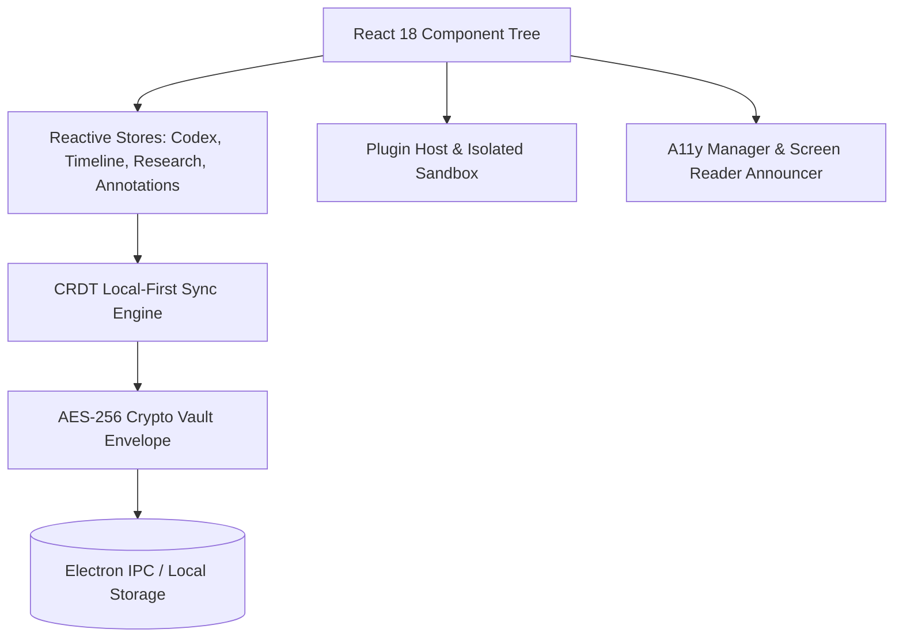

# OpenScriv v1.0.0 — Mimari Tasarım Belgesi (Architecture V1)

## 1. Genel Mimari Bakış (Architectural Overview)
OpenScriv, masaüstü odaklı, **Local-First**, veri kaybı riskini sıfıra indiren reaktif bir sistem mimarisine sahiptir.



---

## 2. Temel Modüller ve Sorumluluklar

| Katman | Dosyalar / Dizinler | Fonksiyon |
|---|---|---|
| **Çekirdek Editör** | `src/components/Editor.jsx`, `src/hooks/useAutosave.js` | Daktilo kaydırma, debounced autosave makinesi |
| **Gezinme & Ağaç** | `src/components/Binder.jsx`, `src/components/Virtual/VirtualBinderTree.tsx` | Sanal liste, sürükle-bırak organizasyon |
| **Görsel Planlama** | `src/components/Corkboard.jsx`, `src/components/Outliner.jsx`, `src/components/Timeline/` | Mantar pano, outliner ve hikaye kurgusu |
| **Karakter & Dünya** | `src/components/Codex/`, `src/state/codexStore.ts` | Karakter, mekan veritabanı ve `@mention` ayrıştırma |
| **Derleme & Export**| `src/services/compile/CompileEngine.ts`, `src/services/export/` | Çoklu format derleme ve yayınlama |
| **Sanal & Ölçekleme**| `src/components/Virtual/`, `src/workers/searchIndexWorker.ts` | Devasa projeler için DOM sanallaştırma |
| **Erişilebilirlik** | `src/services/a11y/`, `src/styles/a11y-contrast.css` | WCAG 2.1 AAA kontrast, live-region anonsları |
| **Sıfır-Bilgi Kasa** | `src/services/security/cryptoVault.ts`, `keyDerivation.ts` | PBKDF2 + AES-256-GCM tam disk şifreleme |
| **Eklenti SDK** | `src/services/plugins/`, `src/types/plugins.ts` | Hata korumalı sandbox ve olay yayımı |

---

## 3. Veri Güvenliği ve Şifreleme (Cryptographic Envelope)
Proje verileri kaydedilirken şu zarf (envelope) yapısı kullanılır:
```typescript
interface EncryptedEnvelope {
  version: 1;
  algorithm: 'AES-GCM-256';
  saltHex: string;       // 16 bytes cryptographically secure random salt
  ivHex: string;         // 12 bytes initialization vector
  iterations: 100000;    // PBKDF2 SHA-256 iterations
  ciphertextHex: string; // Authenticated ciphertext with GCM auth tag
}
```

---

## 4. Test Stratejisi ve Kalite Güvencesi
- **Birim & Entegrasyon Testleri:** Vitest ile 490+ birim test her değişiklikte doğrulanır.
- **Performans Sanallaştırma:** 1.000+ elemanlı Binder ve 100+ devasa döküman sanal pencereleme testleri.
- **Cross-Platform CI:** GitHub Actions üzerinde hem Windows hem Ubuntu runner'larında %100 yeşil kalite kapısı.
